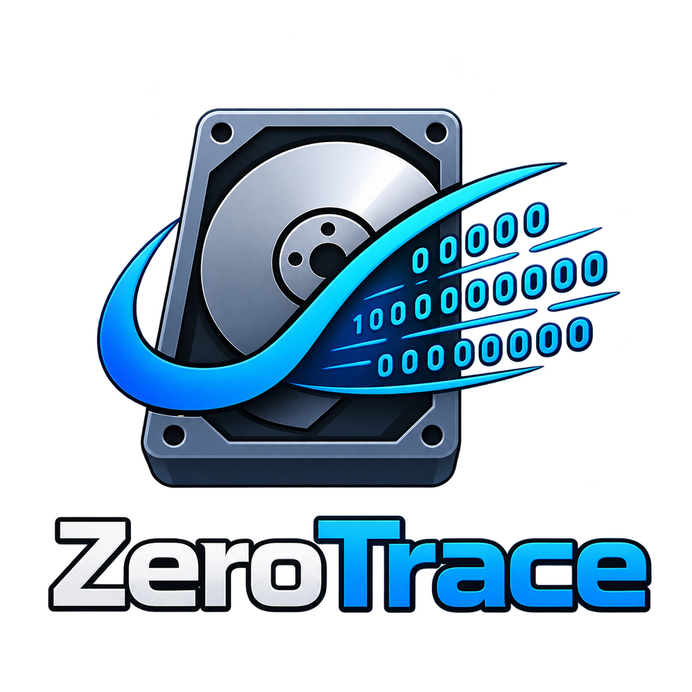
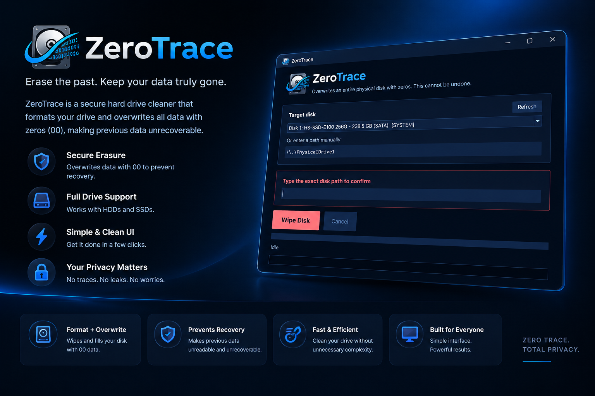

# ZeroTrace
ZeroTrace is a secure hard drive cleaner made to format your drive and overwrite all data with zeros (00), making previous data unrecoverable. Made with ❤ by Ahad#3257

If you find any errors or you have ideas make issues and let me know.

# How To Use?
> [!WARNING]
> DON'T DELETE ANY FOLDER OR ITS CONTENT

You can just download this from [release](../../releases) and run `ZeroTrace.exe` or you can follow the steps below:

It's very simple just follow the steps written below.

Type `pip install -r requirements.txt` to install all required modules

Type `py main.py` in console to launch ZeroTrace Tool.

Select your target disk and confirm path to wipe data safely.

# Features:

- [x] Secure erasure (overwrites data with 00 to prevent recovery).
- [x] Full drive support (works with HDDs and SSDs).
- [x] Simple & Clean UI.
- [x] Disk selection & safety path confirmation.
- [ ] Auto Updater.

# Interface Preview:
***

***

# Note:
Use it but please give credits to author.

Skidding this code is not allowed if you see anyone taking credits of this script dm me on discord.

# Social Media:
[Instagram](https://www.instagram.com/ahad._.x19) ・
[Discord](https://discord.gg/Ncsc5pRNgf) ・
[Website](https://www.itscruel.cf/) 

# Discord: Ahad#3257
If you liked this repo please don't forget to give it a star it would mean a lot.